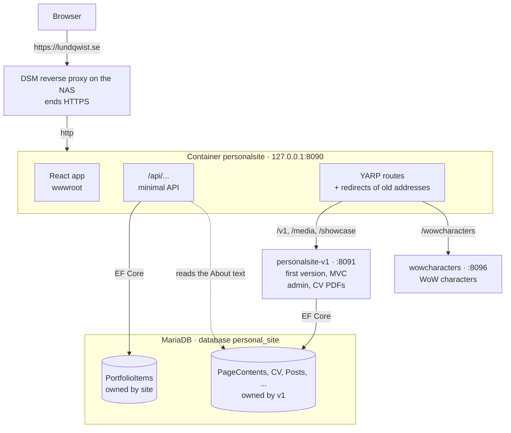
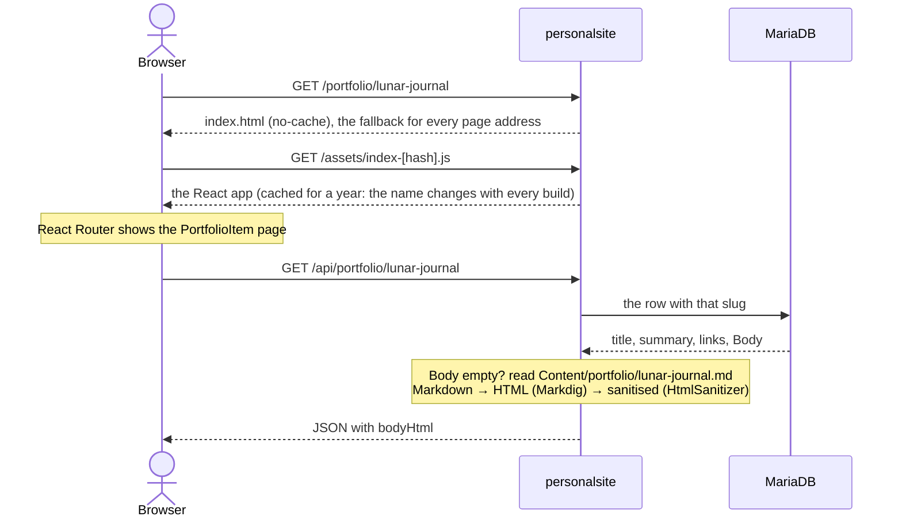

# lundqwist.se

The personal website of **Bjarne M. Lundqwist**. This repository holds two sites:

| Folder | What | Address |
|---|---|---|
| [`site/`](site) | The current site: Portfolio, Projects and About. **C# / ASP.NET Core 8**, **Entity Framework Core**, **MariaDB** and **React** | https://lundqwist.se |
| [`v1/`](v1) | The first version: CV, stories, projects, gaming and an admin area. ASP.NET Core 8 MVC, EF Core, MariaDB. Kept running as a portfolio piece | https://lundqwist.se/v1/ |

Both are self-hosted on a Synology DS220+ and share one MariaDB database.

## Architecture



Everything comes in through one door. DSM's reverse proxy ends HTTPS and hands the request to the `personalsite`
container, which either serves the React app, answers `/api/...` itself, or passes the request on with YARP to one
of the other apps. Each of those apps listens only on `127.0.0.1`, so the only way in is through the front site.

What happens when someone opens a portfolio item:



- **`site/`** is one small ASP.NET Core app (`Program.cs`). It answers `/api/portfolio`,
  `/api/portfolio/{slug}` and `/api/about`, serves the built React app from `wwwroot/`,
  and passes `/v1/...` and `/wowcharacters/...` on to the other apps with YARP.
- **`site/client/`** is the React app (Vite, React Router). Pages are in `src/pages`,
  the look of the whole site is in `src/styles.css`.
- **`v1/`** runs unchanged except for one setting, `PathBase=/v1`, which makes all its
  links start with `/v1`. Its own README describes it in detail.
- Old addresses (`/CV`, `/CV/Pdf`, `/Stories`, `/Gaming`, `/Admin`, `/Privacy`) are
  redirected to `/v1/...`, so links that are already out there keep working.

### Design decisions

**Put the new site in front of the old one instead of rewriting it.** The first version has an admin area, a CV
that builds PDFs and a lot of content, and it works. Rewriting all of that first would have held the new site back.
So the new site went live in front of it, and the old site runs on unchanged behind it under `/v1`.
Its only change is one setting, `PathBase=/v1`. Old addresses that are already out there, such as the CV link in job
applications, are redirected rather than broken. The cost is two apps to run and deploy, and the About text and the CV are
still edited in the old admin. Parts can move over one at a time, when there is a reason to move them.

**One front door, with the routes in code.** The other apps (the first version, the guild site, the WoW characters)
are reached through YARP inside the front site, not through more rules in DSM's reverse proxy. The routes are then in
`Program.cs`, version-controlled and reviewable, and the same setup works on a laptop: Vite's dev server passes
`/api`, `/v1`, `/media` and `/showcase` on to the C# app the same way. Every app knows the path it lives under (its
`PathBase`), so the proxy passes requests on unchanged and keeps the original `Host` header. A new app costs one route
and one cluster. The cost is a single point of failure: if `personalsite` is down, so is everything behind it.

**One database, but each table has one owner.** Both sites use the same MariaDB database, which keeps backups and the
phpMyAdmin view in one place. To keep them from getting in each other's way, the new site keeps its own migration
history (`__EFMigrationsHistory_Site`), and it reads v1's `PageContents` table with `ExcludeFromMigrations()`, so its
migrations can never change a table it doesn't own. The coupling that is left is deliberate and small: one read of one
row.

**The API serves the React app itself.** The built React app is static files in the C# app's `wwwroot`, so pages and
API share one origin. That means no CORS, one container and one deploy. Every address that isn't a file or an API call
gets `index.html`, and React Router picks the page. Caching follows from Vite's file names: `/assets/*` contain a
fingerprint, so they are cached for a year as `immutable`, and `index.html` is `no-cache` so a deploy shows up at once. An
unknown `/api/...` address is a real 404, not the React app. The cost of a single-page app is that pages are
rendered in the browser. For a small portfolio that is fine, but server rendering or prerendering would help search
engines and the first page view.

**Small API, shaped for its pages.** Three GET endpoints, each returning exactly what one page needs as an anonymous
object (the list doesn't send the long texts). There are no DTO classes or services until there is something to share.

**Markdown is turned into HTML on the server and sanitised there.** Texts are written in Markdown (in the database or
in `Content/portfolio/*.md`). `MarkdownRenderer` converts them with Markdig and then runs HtmlSanitizer, which removes
scripts and event attributes and allows only `http`, `https` and `mailto` links. React can then insert the HTML as it
is. Doing it in one place on the server means the browser never gets unsafe HTML, and the settings are the same as
v1's, so a text looks the same on both sites.

**The database is the truth, the repository is the starting point.** `SeedData` only fills an empty table. Changes to
live rows, such as new items, new columns or moved links, are EF Core migrations, so the local and the live database
go through the same steps. A long text can live in the repository as a Markdown file (often a copy of the project's
README) and is used when the row's `Body` is empty. The file is looked up from the row's slug, never straight from the
address.

**Deploys without an image or a registry.** Both containers run Microsoft's `aspnet:8.0` image with the published app
mounted read-only and `network_mode: host`, listening on localhost only. Secrets (the database connection string) live
only in a `.env` file on the NAS. `deploy.ps1` publishes and mirrors the files to the share. Before copying, it
*deletes* every file it will replace. Overwriting files in place under the running site made it fail with empty 500
errors, while a deleted file stays readable for the running process until the restart.

**Security where it matters.** Forwarded headers are trusted only from the proxy on the same machine, so HTTPS
redirects and secure cookies work behind it, and HSTS is on in production. The admin area in v1 has antiforgery tokens on
every form and a rate limit of five login attempts a minute. Files in `/showcase` get a `sandbox` Content-Security-Policy, so
pages uploaded there can't act as the signed-in admin even though they share the domain.

### What I would change next

- Tests and a CI build: at least the API endpoints (with an in-memory or container database) and the YARP routes and
  redirects, which are easy to break without noticing.
- Restart the containers from the deploy script, instead of by hand in DSM.
- Prerender the pages that rarely change (Home, Projects, the portfolio items), for search engines and a faster first
  view.
- Move the About text and the CV over to the new site, so v1 can become read-only.

## Content

| What | Where it comes from | How to change it |
|---|---|---|
| Portfolio items | Table `PortfolioItems` | Edit the rows in the database (phpMyAdmin on the NAS). `site/Data/SeedData.cs` only fills an empty table |
| Portfolio pictures | `site/client/public/images/portfolio/` | Add the file, set the row's `ImageUrl` to `/images/portfolio/<file>`, deploy |
| A portfolio item's page text | Column `Body` (Markdown) | Edit the row |
| About text | Table `PageContents`, row `About` (owned by v1) | https://lundqwist.se/v1/Admin/About |
| CV PDFs (English, Swedish) | Built by v1 from the CV in the database | https://lundqwist.se/v1/Admin |
| Front page pictures | `site/client/public/images/{portfolio,projects,about}.webp` | Replace the files (square-ish, about 500 px wide or more), deploy |

## Running locally

The database connection string is read from `dotnet user-secrets` (both projects
share the same secret, `ConnectionStrings:DefaultConnection`).

```powershell
# 1. The first version, under /v1 (only needed for /v1 links and the CV PDFs)
dotnet run --project v1 --no-launch-profile -- --environment=Development --urls=http://localhost:8091 --PathBase=/v1

# 2. The new site's C# app
dotnet run --project site          # http://localhost:5080

# 3. The React app with live reload while you edit
cd site\client
npm install
npm run dev                        # http://localhost:5173 (passes /api and /v1 on to 5080)
```

Without step 3, run `npm run build` once in `site\client`; the C# app then serves
the built React app itself on port 5080.

Database changes: edit the models in `site/Models`, then
`dotnet ef migrations add <Name> --project site`. Migrations are applied when the
site starts. The new site keeps its migration list in `__EFMigrationsHistory_Site`,
separate from v1's.

## Deploying

```powershell
.\deploy.ps1              # both sites
.\deploy.ps1 -Only site   # only the new site
```

It builds the React app, publishes both projects and copies them to
`\\LUNARBASE\docker\personalsite` (`site/` and `app/`), together with
`deploy/docker-compose.yml`. Then in DSM: Container Manager → Project →
*personalsite* → Action → **Restart**. When `docker-compose.yml` has changed,
Stop the project and **Build** it instead, so the containers are recreated.

## Copyright

© 2026 Bjarne M. Lundqwist. All rights reserved. See [`v1/README.md`](v1/README.md)
for the full notice and the third-party components of the first version. The new
site also uses React, React Router and Vite (MIT), YARP (MIT) and the Raleway
typeface (SIL Open Font License 1.1), bundled with the site.
